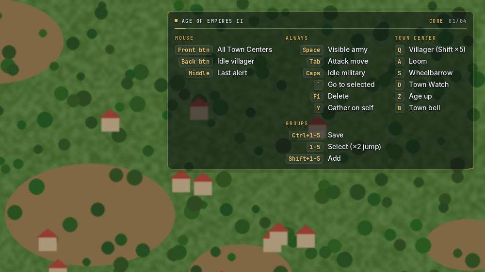
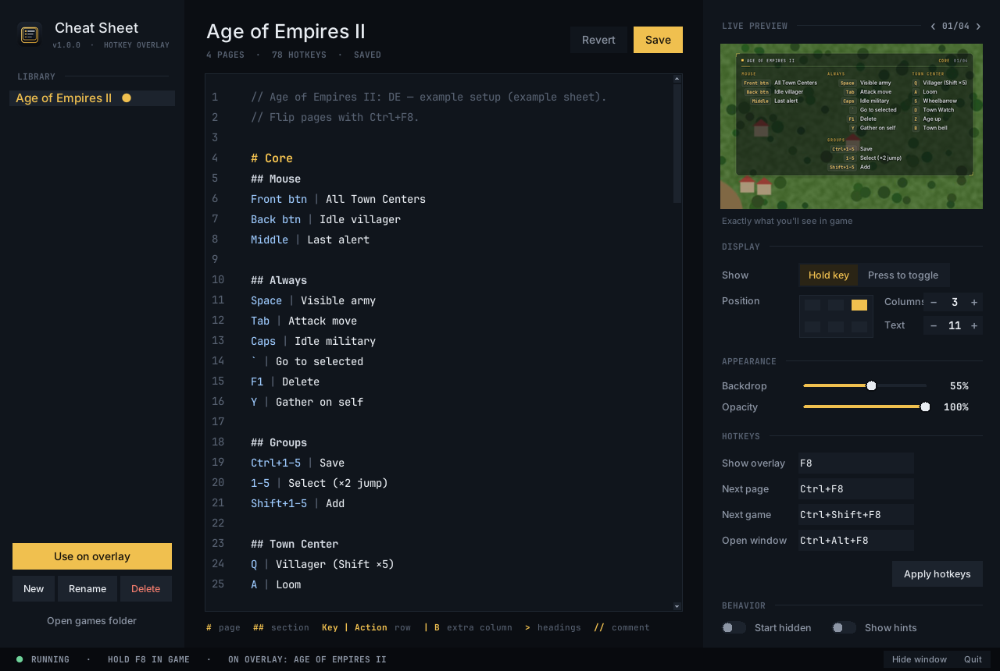
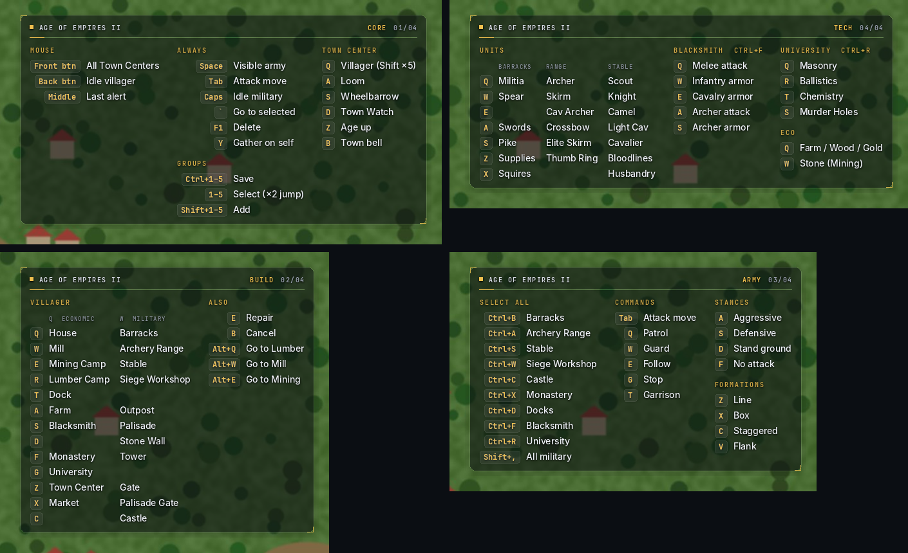

<p align="center">
  
</p>

<h1 align="center">Cheat Sheet</h1>

<p align="center">
  A clean, see-through hotkey overlay for games.<br>
  Hold a key, glance at your binds, let go. That's it.
</p>

<p align="center">
  
</p>

---

## Features

- **Peek, don't clutter.** Hold <kbd>F8</kbd> to show your cheat sheet and let go to hide it. Or switch to press-to-toggle.
- **Glass-clean overlay.** A faint, adjustable backdrop sits behind crisp text with true per-pixel transparency. Turn the backdrop off entirely for text only.
- **Never in the way.** The overlay is click-through, never steals focus from your game and stays out of Alt+Tab.
- **One file per game.** Sheets are plain text, so they're easy to write, share and keep in Git.
- **Pages, sections and tables.** Flip pages with <kbd>Ctrl</kbd>+<kbd>F8</kbd>. Put menus side by side with multi-column rows.
- **Live preview.** The manager shows exactly what you'll see in game as you type.
- **Your hotkeys.** Every global hotkey is configurable.

<p align="center">
  
</p>

## Install

1. Download **`CheatSheet-Setup-x.y.z.exe`** from the [Releases](../../releases) page and run it.<br>
   Prefer no installer? Grab the standalone **`CheatSheet.exe`** instead.
2. Launch **Cheat Sheet**, pick a game in the library, and click **Use on overlay**.
3. In game, hold <kbd>F8</kbd>.

> **Tip:** set your game to **Borderless** or **Windowed** display mode. Windows can't draw an overlay on top of exclusive fullscreen.

Windows 10 and 11 (64-bit). The `.exe` isn't code-signed yet, so Windows SmartScreen may show "Windows protected your PC". Click **More info → Run anyway**.

## Default hotkeys

| Action | Hotkey |
| --- | --- |
| Show overlay (hold, or press to toggle) | <kbd>F8</kbd> |
| Next page | <kbd>Ctrl</kbd>+<kbd>F8</kbd> |
| Next game | <kbd>Ctrl</kbd>+<kbd>Shift</kbd>+<kbd>F8</kbd> |
| Open the Cheat Sheet window | <kbd>Ctrl</kbd>+<kbd>Alt</kbd>+<kbd>F8</kbd> |

All of these can be changed in the app.

## Writing a sheet

Sheets live in `%APPDATA%\Cheat Sheet\games`, one `.txt` file per game. Edit them in the app, or in any text editor.

```text
# Core                      ← a page (flip with Ctrl+F8)
## Always                   ← a section
Space | Visible army        ← key | what it does
Tab | Attack move

# Build
## Villager
> | Economic | Military     ← column headings
Q | House | Barracks        ← extra columns sit side by side
W | Mill | Archery Range

// comments are ignored, and any other line shows as a small note
```

An Age of Empires II sheet is included as an example.

<p align="center">
  
</p>

## Build from source

Requires Python 3.9+ on Windows.

```bat
git clone https://github.com/braydendolph/cheat-sheet.git
cd cheat-sheet
run.bat            :: run from source (installs Pillow on first run)
build.bat          :: build dist\CheatSheet.exe (+ installer if Inno Setup 6 is installed)
```

**Releases are automated.** Push a tag like `v1.0.0` and GitHub Actions builds `CheatSheet.exe` and the installer, then attaches them to a new release.

### Project layout

```
cheatsheet/
  ui.py        manager window (Tk)
  render.py    draws the overlay image (Pillow)
  overlay.py   click-through layered window (Win32)
  hotkeys.py   global hotkeys
  sheet.py     sheet format parser
  config.py    settings, paths and the games library
assets/        logo, icon, fonts, installer art
games/         sheets bundled on first run
installer/     Inno Setup script
```

Add a `portable.txt` file next to `CheatSheet.exe` to keep settings and sheets beside the app instead of in `%APPDATA%`.

## FAQ

**Is it safe with anti-cheat?** Cheat Sheet is an ordinary transparent window. It doesn't read, inject into or modify any game. If a game's rules forbid overlays, follow them.

**A hotkey doesn't work.** Another app may already own it, and the status bar will say so. Pick a different key and click **Apply hotkeys**.

## Credits

Typefaces: [Inter](https://rsms.me/inter/) and [JetBrains Mono](https://www.jetbrains.com/lp/mono/), both under the SIL Open Font License (see `assets/fonts`).

## License

[MIT](LICENSE)
